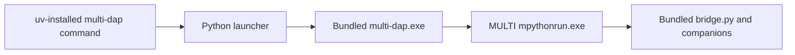

# uv tool distribution

The local Windows amd64 wheel contains the existing native release bundle and
a small Python console entry point. It can be installed with `uv tool install`
without Go or a source checkout on the destination workstation. No PyPI package
or public wheel release is configured by this change.

## Design and runtime contract



The launcher uses its installed module path to select the absolute native
executable. The native executable already discovers `bridge/bridge.py` beside
itself, including when `ensure` starts a detached `serve` child. Keeping the
ZIP layout intact therefore avoids a second bridge-discovery implementation.
Explicit `--bridge-script` arguments retain their existing native semantics.

The wrapper forwards every argument, inherits the working directory and
environment, and gives the child the original stdin, stdout and stderr handles.
There is no shell, output banner, text decoding, DAP buffering, argument parser,
or implicit acquisition. The native exit code is returned unchanged. A missing
executable, unsupported host, or spawn failure reports an error on stderr and
returns 126. Console Ctrl+C lets the native child finish cleanup while the
wrapper waits; the wrapper never kills a child after `KeyboardInterrupt`.
Forced IDE process termination remains a separate process-tree behavior and
requires editor acceptance.

The wheel needs a Windows amd64 host and 64-bit Python 3.10 or later. Python
3.10 and 3.12 are used for CI installation checks. This Python only runs the
launcher. The bridge still runs through the configured MULTI installation's
embedded Python, and native trace still uses its existing vendor runtime.
The wrapper does not import bridge modules, change `PYTHONPATH`, or distribute
MULTI, vendor DLLs, firmware, or a completed project configuration.

## Installed layout

```text
site-packages/
  multi_dap/
    __init__.py
    bundle-origin.json
    _bundle/
      multi-dap.exe
      bridge/
        bridge.py
        mbp_wire.py
        timemachine_helper.py
        timemachine_native.py
      editors/clion/...
      examples/multi-dap.example.toml
      README.md
      LICENSE.txt
      THIRD_PARTY_NOTICES.md
      licenses/...
      SHA256SUMS.txt
      release-provenance.json
  multi_dap-<python-version>.dist-info/
    METADATA
    WHEEL
    entry_points.txt
    RECORD
    licenses/LICENSE.txt
```

`uv` exposes the console script as `multi-dap.exe` in its tool bin directory.
That command and the native `_bundle/multi-dap.exe` are separate files. The
wheel tag is `py3-none-win_amd64`, with `Root-Is-Purelib: false` and
`Requires-Python: >=3.10`. It contains a native executable without a Python ABI
dependency; an `any` platform tag would incorrectly advertise other hosts.
See the official [wheel format](https://packaging.python.org/en/latest/specifications/binary-distribution-format/)
and [platform tag specification](https://packaging.python.org/en/latest/specifications/platform-compatibility-tags/).

## Build a local wheel

Run from the repository root on a prepared build workstation. Go dependencies
and Python 3.12 must already be available for the offline commands. Choose a
new output directory; both packagers refuse to overwrite existing artifacts.

```powershell
New-Item -ItemType Directory -Path .\dist\wheel-candidate | Out-Null
.\scripts\New-WindowsPackage.ps1 `
  -OutputDirectory .\dist\wheel-candidate `
  -Version '0.0.0-dev' `
  -SourceDateEpoch 315532800
if ($LASTEXITCODE -ne 0) { throw 'Native package build failed' }

$archive = (Resolve-Path .\dist\wheel-candidate\multi-dap-0.0.0-dev-windows-amd64.zip).Path
uv build --wheel .\packaging\python `
  --offline --no-python-downloads --python 3.12 `
  --out-dir .\dist\wheel-candidate -C "archive=$archive"
if ($LASTEXITCODE -ne 0) { throw 'Wheel build failed' }
```

`packaging/python/pyproject.toml` selects a small, standard-library-only
[PEP 517 backend](https://peps.python.org/pep-0517/). The backend only repackages
an explicit existing ZIP; it cannot build an sdist, fetch a binary, run Go, or
execute the supplied EXE. This keeps the native build and its provenance in
`New-WindowsPackage.ps1`, while allowing the normal `uv build --wheel` interface
without additional build or runtime packages.

The backend verifies the adjacent `.zip.sha256`, the exact Windows payload
allowlist and internal `SHA256SUMS.txt`, provenance target/version/binary hash,
and the EXE's AMD64 PE header. It rejects missing companions, duplicate paths,
extra files, and invalid paths before copying any payload. Archive paths are
never extracted during conversion. All native ZIP file bytes, including
license files and provenance, are preserved under `_bundle`.

The native provenance timestamp, fixed file order/permissions and stored ZIP
entries make repeated wheel builds byte-identical for identical inputs. Wheel
`RECORD` hashes cover the wrapper, bundle and metadata; `bundle-origin.json`
records the original archive digest and both version spellings. These hashes
detect mismatched files; they are not independent authentication of a source.
Use a locally built or otherwise trusted/verified ZIP as the input.

The native version remains authoritative for `multi-dap version`. Python
metadata uses an explicit PEP 440 mapping:

| Native version | Wheel version |
|---|---|
| `1.2.3` | `1.2.3` |
| `0.0.0-dev` | `0.0.0.dev0` |
| `1.2.3-dev.4` | `1.2.3.dev4` |
| `1.2.3-alpha.1` | `1.2.3a1` |
| `1.2.3-beta.2` | `1.2.3b2` |
| `1.2.3-rc.3` | `1.2.3rc3` |
| `0.0.0-ci.123` | `0.0.0.dev123+ci` (local CI only) |

An omitted prerelease number normalizes to zero. Other suffixes, leading-zero
numeric components, and SemVer build metadata are rejected instead of being
guessed. Versions with the same normalized Python identity must not be used
for different published artifacts. CI local versions are not PyPI releases.

## Install and use

On the destination Windows amd64 workstation:

```powershell
uv tool install --python 3.12 .\multi_dap-0.0.0.dev0-py3-none-win_amd64.whl
uv tool list
Get-Command multi-dap -All
multi-dap version
multi-dap check --config C:\private\project.toml
```

When Python 3.12 is already installed, add `--offline --no-python-downloads`
to installation for an offline-only workflow. There are no Python package
dependencies to resolve. If the tool bin directory is absent from `PATH`, use
its full command path or follow `uv`'s `tool update-shell` instructions.
See the official [uv tool guide](https://docs.astral.sh/uv/guides/tools/).
If a ZIP/WinGet installation also supplies `multi-dap`, inspect command
resolution and select the intended absolute executable in scripts and IDEs.

After completing the private project TOML and selecting the acquisition mode,
the CLI keeps the existing lifecycle interface:

```powershell
multi-dap ensure --config C:\private\project.toml --acquisition cold
multi-dap proxy --config C:\private\project.toml
```

`cold` is an explicit target-connection choice. Use the existing documented
warm arguments to select an operator-owned session; the launcher does not
choose an acquisition mode. The proxy expects the editor's DAP conversation
over stdin/stdout. See [operations](operations.md) for lifecycle semantics.

For an IDE that requires an absolute adapter path, use the uv-exposed command
shown by `Get-Command multi-dap`. Existing CLion profiles that deliberately
specify `--bridge-script` can retain a selected ZIP bundle or point to the
installed bundle. For inspection and copying the example, uv's current Windows
tool layout can be queried with its own interpreter:

```powershell
$toolRoot = uv tool dir
$toolPython = Join-Path $toolRoot 'multi-dap\Scripts\python.exe'
$bundle = & $toolPython -I -c 'import multi_dap; print(multi_dap.bundle_directory())'
Copy-Item -LiteralPath (Join-Path $bundle 'examples\multi-dap.example.toml') `
  -Destination C:\private\new-project.toml
```

The `uv tool dir` layout is not a stable application API; use it for discovery,
not a hard-coded site-packages path in a profile. Keeping automatic bridge
lookup avoids retaining an internal path across updates. Actual IDE GUI and
target acceptance of the uv wrapper remains separate from the local CLI smoke.

Before replacing or uninstalling a tool, finish active debug sessions and shut
down every daemon using that installation through its existing configuration
and control directory. For example, after choosing to end that session:

```powershell
multi-dap shutdown --config C:\private\project.toml
uv tool install --reinstall --python 3.12 C:\packages\multi_dap-0.1.0-py3-none-win_amd64.whl
# Or, when removing this installation:
uv tool uninstall multi-dap
```

The wheel has no install/uninstall hooks that discover, stop, or migrate live
daemons. Tool replacement does not upgrade an already running native process.
Project TOMLs and captures belong outside the installation. Use a persistent
`uv tool install` for daemon/editor use; transient `uvx` environments have no
qualified lifetime contract for a detached daemon.

## Verification and rollout

```powershell
uv run --offline --no-python-downloads --no-project --python 3.12 `
  -m unittest discover -s packaging/python/tests -v
uv run --offline --no-python-downloads --no-project --python 3.12 `
  .\packaging\python\tests\smoke_install.py `
  --wheel .\dist\wheel-candidate\multi_dap-0.0.0.dev0-py3-none-win_amd64.whl
```

Host tests cover deterministic bytes, complete wheel hashes, version mapping,
invalid archives, platform rejection, argument forwarding, interrupt handling,
and a real child preserving binary streams, Unicode arguments, and cwd. The
Windows smoke installs into isolated `UV_TOOL_DIR`, `UV_TOOL_BIN_DIR`, and
`UV_CACHE_DIR`, compares installed bundle bytes and actual native CLI output,
then reinstalls and uninstalls offline. It never starts MULTI or a daemon and
does not modify the user's normal tool installation or shell configuration.

CI runs the host tests on Windows/Linux. Its independent `Windows uv wheel`
job also runs them on the minimum supported Python 3.10, builds a native ZIP,
compares wheel bytes produced by Python 3.10 and 3.12, and performs the isolated
offline install/reinstall/uninstall smoke with both interpreters. It verifies
that source files remain clean, and the Windows release candidate job requires
this check to pass. Pushes, pull requests, and manual CI dispatches run the job;
ordinary CI does not upload its test package. Local release acceptance also
runs the host tests. The public release/publish workflows and their exact asset
allowlists remain unchanged. Adding PyPI or release-wheel publication requires
an explicit package-identity decision, immutable version policy, wheel
attestation, hosted acceptance, and review of those publication workflows.
The current deliverable is the local wheel and launcher, with no new hardware
qualification claim.
